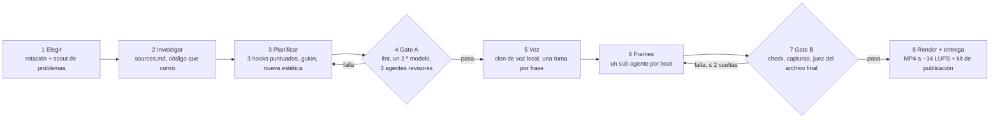

<div align="center">

[English](README.md) · **Castellano**

# Faceless Video Studio

**Un skill de Claude Code que investiga, escribe el guion, pone voz y renderiza un video
explicativo terminado cada día — con [HyperFrames](https://github.com/heygen-com/hyperframes),
un clon de código abierto de tu propia voz que corre sin conexión (inglés e hindi), y 44 gates
de aprobado/rechazo que frenan el "AI slop" antes de publicarlo.**

Sin cámara. Sin avatar. Sin línea de tiempo de edición. Sin suscripción de voz. Lo único que
pagás es Claude Code. Revisás un MP4 por la mañana y lo publicás, o le pasás su `POST.json` a
tu propio subidor y dejás que un cron lo haga.

> [!IMPORTANT]
> **¿Ya tenés Claude Code en una suscripción de Claude (Pro o Max)? Cada video te cuesta ₹0 / $0
> extra.** Los $11–30 por corrida que se citan más abajo son la estimación *equivalente en API*
> que imprime Claude Code. Solo la pagás si corrés Claude Code con facturación de API por uso.
> En una suscripción, una corrida solo consume parte de los límites de uso de tu plan. La voz y
> el renderizado son gratis en ambos casos.

<a href="https://github.com/cybiqon-ai/faceless-video-studio/releases/download/v1.0.1/demo.mp4"></a>

<sub>Resultado real: un explicativo de blog que el estudio hizo el 12 de octubre de 2026, hojas
de contacto de sus primeros 14 videos, y las piezas de demostración de los siete estilos de
animación con los que viene. ▶ <a href="https://github.com/cybiqon-ai/faceless-video-studio/releases/download/v1.0.1/demo.mp4">Mirá la versión de 40 segundos con sonido</a> (narrada con el
clon de HeyGen que usaba el estudio antes de pasarse a voces de código abierto).</sub>

[](LICENSE)


[Cómo funciona](#cómo-funciona) · [Inicio rápido](#inicio-rápido) · [Qué cuesta](#qué-cuesta) ·
[Los gates](#los-44-gates) · [Integralo en tu pipeline](#integralo-en-tu-pipeline) · [Programación](docs/scheduling.md) · [La historia completa](https://cybiqon.in/lab/open-source-ai-video-studio-claude-code)

</div>

---

## Qué hace

Videos reales hechos por este estudio, narrados por un clon de la voz del fundador. Los
primeros tres usan el clon de código abierto Pocket TTS que el estudio corre hoy, hecho sin
conexión en una CPU de 4 núcleos; los últimos tres usaron el clon de HeyGen que tenía antes
del 15 de octubre de 2026:

| Video | Formato | Qué muestra |
|---|---|---|
| [In this puzzle game, light can teleport. Stones can't.](https://youtu.be/PHj-BNQHcuE) | Short de producto, 47 s | Gameplay real impulsado por el propio solver del juego: se muestra la mecánica, y después se resuelve |
| [Coding agents ace benchmarks. On 95 realistic delivery jobs, the best resolved 14](https://youtu.be/1j_GwfF1mSY) | Explicativo, 149 s | Un paper de investigación explicado desde sus propias páginas, en pantalla dividida |
| [A 3B-active model tied Kimi K3 on Kaggle](https://youtu.be/NtXKZbDEovs) | Explicativo, 148 s | Qué hizo realmente el trabajo, desde el artículo original |
| [Google gave its newest AI real jobs](https://youtu.be/Tuv_wF5Yhw4) | Explicativo, 117 s | Metraje real de la página fuente con highlights dibujados sobre las frases exactas |
| [Jev, explained](https://youtu.be/el5VAfAQASM) | Explicativo, 118 s | Un post de blog convertido en video educativo |
| [How OpenAI trained agents to run enterprise software](https://youtu.be/sXXElHX-7SU) | Explicativo | Una noticia explicada para principiantes |

Viene con **pilares** para términos de IA, Python, "construí una cosa", noticias de
tecnología, promos de producto y servicio, y explicativos de blog, además de **deep dives de
formato largo de 4 a 8 minutos**, **22 familias de estética** para que dos videos seguidos
nunca comparten plantilla, y **tres motores de render** (HyperFrames, más los estilos
vendorizados de [animate](https://github.com/cth9191/animate) y Manim opcional).

## Cómo funciona



1. **Elegir.** `ledger.py today` devuelve el pilar y el formato del día según tu rotación, y
   rechaza cualquier tema cercano a un video que ya hayas hecho. Para los videos educativos, un
   agente [scout de problemas](skill/video-studio/references/problem-scout.md) busca primero en
   Stack Overflow, issues de GitHub, Hacker News, el "la gente también pregunta" de Google y
   foros de desarrolladores (≥ 12 búsquedas, ≥ 4 tipos de fuente) problemas que los
   desarrolladores realmente están preguntando, y el video tiene que arrancar de uno que
   puntúe ≥ 9/15 con ≥ 2 enlaces como prueba (A21).
2. **Investigar.** Todo dato tiene una URL de fuente. Los videos educativos corren su código
   primero, y solo la salida real va en pantalla.
3. **Planificar.** Tres hooks de una biblioteca de 20 plantillas reales de Shorts, puntuados
   sobre 12; un guion de 35–60 s para desarrolladores que ya programan, con un artefacto que
   valga la pena guardar; y una estética elegida de las familias usadas menos recientemente.
4. **Gate A — antes de gastar tiempo en la voz.** Un linter; después, opcionalmente, una
   **segunda opinión de una familia de modelos distinta** vía OpenRouter, que revisa el guion y
   escribe su propia versión para que el agente adopte lo que sea mejor (A22, unos $0.03 por
   guion); y después tres sub-agentes frescos: un desarrollador de nivel medio que tiene que
   nombrar algo nuevo que aprendió (con un juez separado), un experto que señala cualquier
   falsedad, y un espectador frío que solo ve los primeros tres segundos.
5. **Voz.** Una toma por frase de un clon de código abierto de tu voz, hecho en tu propia CPU:
   [Pocket TTS](https://github.com/kyutai-labs/pocket-tts) para inglés,
   [IndicF5](https://github.com/AI4Bharat/IndicF5) para hindi y otros 10 idiomas de la India.
   Cada toma se cronometra con faster-whisper y se recorta sobre el sonido real (nunca sobre
   timestamps, que llegan tarde y cortan palabras), se nivela a −16 LUFS, y se registra en un
   manifiesto con hash.
6. **Frames.** Un sub-agente por beat construye HTML + GSAP en paralelo; HyperFrames lo
   ensambla.
7. **Gate B.** `hyperframes check`, capturas que el agente realmente mira, y un juez que
   revisa frames decodificados del MP4 final.
8. **Entrega.** `deliver.py` rechaza el video a menos que estén todas las líneas de revisión,
   todas las líneas de voz estén limpias, la música quede ≥ 20 dB por debajo de la voz
   (`mix_check.py`) y un Short llene su cuadro; después manda el MP4 y un kit de publicación
   (títulos, descripciones, hashtags, enlaces rastreados, fuentes) a Telegram — o lo guarda
   localmente — e imprime una línea `Rendered: <slug> …` que un scheduler puede chequear.

El estudio en sí **nunca publica**: vos decidís qué sale bajo tu nombre. Mirálo y publicalo a
mano, o [conectá tu propio subidor](#integralo-en-tu-pipeline) — nosotros publicamos el
nuestro en YouTube y X desde un cron.

## Inicio rápido

Necesitás **Linux** (nosotros corremos Ubuntu 24.04; macOS funciona con `timeout` y `flock` de
GNU vía Homebrew), **Node.js 22+**, **Python 3.10+**, **FFmpeg**,
[Claude Code](https://code.claude.com), una cuenta gratuita de
[Hugging Face](https://huggingface.co) (los modelos de voz están con acceso restringido) y
~5 GB de disco para ellos. Sin GPU y sin servicio de voz de pago.

**1. Instalá HyperFrames y sus skills de agente** (proveen el renderer y los ayudantes de
medios para música, efectos de sonido y subtítulos):

```bash
claude plugin marketplace add heygen-com/hyperframes
claude plugin install hyperframes@hyperframes
# o, sin el plugin:
npx skills add heygen-com/hyperframes
```

**2. Instalá este skill.** O como plugin de Claude Code (un comando, se autoactualiza):

```bash
claude plugin marketplace add cybiqon-ai/faceless-video-studio
claude plugin install faceless-video-studio@faceless-video-studio
mkdir ~/my-studio   # tu carpeta de estudio; el setup del paso 5 la llena
```

…o cloná el repo y corré el instalador, que chequea tus herramientas, enlaza el skill en
`~/.claude/skills/video-studio` y crea la carpeta de estudio a partir de `studio.example/`:

```bash
git clone https://github.com/cybiqon-ai/faceless-video-studio.git
cd faceless-video-studio
./install.sh ~/my-studio
```

Como plugin el comando es `/faceless-video-studio:video-studio`; más abajo está escrito como
`/video-studio`.

**3. Instalá un motor de voz.** Aceptá los términos del modelo en Hugging Face
([Pocket TTS](https://huggingface.co/kyutai/pocket-tts) para inglés,
[IndicF5](https://huggingface.co/ai4bharat/IndicF5) para hindi), hacé login una vez, y después
instalalo en tu estudio (en su propio virtualenv en `~/my-studio/.venvs/`, solo CPU):

```bash
pip install -U huggingface_hub && hf auth login
STUDIO_ROOT=~/my-studio skill/video-studio/scripts/install_voice.sh pocket    # inglés
STUDIO_ROOT=~/my-studio skill/video-studio/scripts/install_voice.sh indicf5   # hindi (opcional)
```

**4. Grabá tu voz una vez** — 20–30 s de habla natural y expresiva en un cuarto silencioso,
guardados como `~/my-studio/voice/sample.wav`. Para hindi, grabá una toma aparte en hindi y
quedate con un clip de 6–10 s que termine en una pausa, con sus palabras exactas en
`config.json` (`voice.variants.hi.reference_text`). [docs/voice.md](docs/voice.md) tiene los
textos para leer y qué hace que un clon suene como vos.

**5. Corré el setup.** Chequea FFmpeg, HyperFrames y el motor de voz, y pone voz a dos frases
de prueba para que las apruebes:

```bash
cd ~/my-studio && claude
> /video-studio setup
```

**6. Hacelo tuyo.** Editá `brand/brand-core.md` (tu color de acento y tu handle),
`brand/pillars.md` (tu audiencia, productos y tie-ins honestos) y `brand/products.json` (los
enlaces a los que apuntan las promos). `examples/cybiqon/` es una marca real, ya completada.

**7. Hacé tu primer video** y mirálo de principio a fin:

```bash
> /video-studio plan "qué es un embedding"   # investigación + plan + Gate A solamente, sin gastar en voz
> /video-studio daily                          # la corrida completa: el pilar de hoy según tu rotación
```

El MP4 queda en `videos/<fecha>-<slug>/hf/renders/video.mp4`, con `POST-KIT.html` al lado.

**8. Opcional: ponerlo en Telegram.** Agregá `TELEGRAM_BOT_TOKEN` y `TELEGRAM_CHAT_ID` a
`.env` y probalo desde tu estudio:
`cd ~/my-studio && python3 ~/faceless-video-studio/skill/video-studio/scripts/telegram.py "hola"`.

**9. Opcional: más motores.** Los estilos de animate necesitan `npm install` en
`skill/video-studio/vendor/animate`; Manim necesita su propio venv. El instalador imprime
ambos comandos.

**10. Programalo** una vez que algunas corridas manuales se vean bien — mirá
[docs/scheduling.md](docs/scheduling.md):

```cron
PATH=/home/USER/.nvm/versions/node/v22.11.0/bin:/home/USER/.local/bin:/usr/local/bin:/usr/bin:/bin
0 23 * * *  STUDIO_ROOT=/home/USER/my-studio /home/USER/faceless-video-studio/bin/run.sh
```

Cron tiene un `PATH` corto: ponelo donde vivan `claude`, `node` y `npx` (`which claude node`).
Con la instalación como plugin, agregá `STUDIO_SKILL=faceless-video-studio:video-studio` y
llamá al `bin/run.sh` desde un clon de este repo.

## Qué cuesta

De los primeros cuatro días del propio estudio (octubre de 2026), en los que hizo 12 videos
terminados:

| Ítem | Costo |
|---|---|
| Voz, código abierto en tu CPU | **$0**: Pocket TTS a ~1× tiempo real (inglés), IndicF5 a ~30× (hindi) en 4 núcleos |
| Voz antes del 15 de octubre de 2026 (clon de HeyGen, para comparar) | $8.20 por los 12 videos más revisiones (~$0.14 por minuto de narración) |
| Corrida de Claude Code, un Short de 85 s | ~$18.35 a tarifas de API, $0 extra en una suscripción (estimación que reporta Claude Code; ~$10 de eso son los 11 workers paralelos de frames) |
| Corrida de Claude Code, un formato largo de 7 minutos + su Short acompañante | ~$26 a tarifas de API, $0 extra en una suscripción |
| Renderizado | tu propia CPU: 2.5–19.5 min por video en 4 núcleos |

Las seis corridas cuyo costo registramos entre el 12 y el 17 de octubre de 2026 (Shorts y
explicativos de 2.5 minutos) salieron **$11–20.50** cada una a tarifas de API. Los extras
opcionales cuestan centavos: la segunda opinión de A22 sale unos **$0.03** por guion en
OpenRouter, y una `HEYGEN_API_KEY`, si configurás una, la usa solo la propia búsqueda de
música y efectos de sonido de HyperFrames — nunca la voz.

Todo el gasto obligatorio es el del agente, y solo con facturación de API. `bin/run.sh` pone
un tope a cada corrida con `--max-budget-usd` ($25 para un Short, $60 para un formato largo
por defecto), y `POST.json` tiene un campo `cost_usd`: llenalo desde el primer día. El
desglose completo está en el [artículo](https://cybiqon.in/lab/open-source-ai-video-studio-claude-code).

## Los 44 gates

La mayoría existen porque un video real falló exactamente de esa forma. `deliver.py` rechaza
un video a menos que las líneas de revisión estén en su plan (A16, A18–A21, y A22 cuando hay un
modelo de segunda opinión configurado), y chequea el texto de publicación (A23), el título y
las miniaturas (A24), la voz (B17), el llenado del cuadro (B18), el volumen (B19) y el nivel
de la música:

| Gate | Regla | La falla detrás |
|---|---|---|
| **A8** | 35–60 s, se mantiene la pausa configurada después de cada frase; se cortan frases, no pausas | El primer Short: 97 palabras en 44 s, "demasiado rápido"; después, un ritmo de principiante de 60–90 s perdió 67 % en 3 s |
| **A14–A16, A18** | Escrito para desarrolladores que ya programan; ≥ 1 artefacto y 3 datos específicos por 30 s; linteado; un desarrollador de nivel medio tiene que aprender algo nuevo | Primero "el guion trata al espectador como experto", después la reescritura para principiantes: "demasiado infantil… no aprendí nada útil" |
| **A19** | Un agente experto marca cualquier falsedad | Tres simplificaciones que se habían vuelto falsas |
| **A2, A20** | La frase 1 nombra el sujeto concreto más una tensión, probada en pantalla en 1.5 s | "El hook no tiene sentido"; después 67 % deslizando fuera en 3 s |
| **B11, B13** | El metraje llena el cuadro; ningún video se parece a una plantilla | "Bastante parecido… pronto se va a notar que es generado por IA" |
| **B16, B17** | Sin silencio por encima de la pausa configurada (0.7 s por defecto); cada línea de voz empieza y termina en silencio | Huecos de 3–5 s; un tercio de las frases perdiendo su primera palabra |
| **A21** | Un video educativo arranca de un problema que los desarrolladores están preguntando: ≥ 2 enlaces públicos, ≥ 9/15 | Un Short verdadero y bien hecho sobre un problema que nadie tenía: "no tiene sentido hacer un video sobre un problema que nadie tiene" |
| **A22** | Un modelo de otra familia revisa el guion y escribe su propia versión | Guiones que pasaron todos los gates juzgados por Claude y aun así no enseñaron nada |
| **A23** | ≤ 5 hashtags, ninguno genérico; sin caracteres invisibles, rayas o comillas tipográficas en el caption | Doce kits seguidos con 6–8 hashtags, por encima del tope de 5 de Instagram |
| **A24** | El primer título ≤ 55 caracteres; 3 miniaturas diseñadas, ≤ 4 palabras cada una, para Test & Compare | 10.1k impresiones con un 1.1 % de click-through: títulos cortados en el celular, capturas de pantalla como portada |
| **A25** | La solución o el resultado está en pantalla a los 10 s | Cuatro Shorts que retenían 17–32 %: los espectadores se iban a los 10–18 s, antes de la solución a los 30–40 s |
| **B19** | La voz primero: la mezcla se reconstruye desde los stems, la voz sube, la música no; −12 LUFS o más fuerte | "La voz suena baja al lado de la de otra gente": todos los renders quedaban en −14 LUFS |
| **B18** | Un Short llena su cuadro hasta el borde inferior | Un 40 % inferior vacío en todos los Shorts |
| `mix_check` | Voz nivelada a −16 LUFS; música ≥ 20 dB por debajo | "La voz en off sigue baja" |

Los 44, con lo que chequea cada uno: [docs/gates.md](docs/gates.md). El rubric del que parte
el agente: [`skill/video-studio/references/quality-rubric.md`](skill/video-studio/references/quality-rubric.md).

## Integralo en tu pipeline

El estudio está hecho para ser una etapa dentro de tu propio sistema, no una app cerrada.

- **Un comando para correrlo.** `bin/run.sh [daily|promo|blog|plan <tema>|…]` corre
  `claude -p "/video-studio <modo>"` sin supervisión, con un lock, un límite de tiempo, un tope
  de gasto y una lista de bloqueo, y te avisa cuando no sale ningún video. Salir con código 0
  sin una línea `Rendered:` cuenta como falla. Varias líneas (nosotros corremos explicativos de
  blog a las 12:30, un Short de producto a las 15:15 y un video educativo a las 23:00)
  comparten una máquina a través de un lock.
- **Cuatro plugins**, cada uno un archivo Python chico nombrado en `config.json`, lo conectan
  a tus sistemas sin forkear: `planner` (un calendario de contenido elige temas y los marca
  como "hechos"), `notify` (Telegram por defecto; Slack, email o tu propio bot), `links`
  (enlaces rastreados a tus productos) y `archive` (guardá los renders finales en
  almacenamiento en la nube). Mirá [configuration.md](docs/configuration.md#plugins).
- **Un archivo para pasarle a lo siguiente.** Cada video entregado tiene
  `videos/<fecha>-<slug>/POST.json`, validado por `deliver.py`: tres títulos, una descripción
  de YouTube, un caption sin URLs, hashtags, un comentario fijado, `thumbnail_at`, fuentes y
  `cost_usd`. El MP4 es `hf/renders/video.mp4`, al lado.

**Para publicar automáticamente**, corré tu subidor después de que `bin/run.sh` imprima su
línea `Rendered:`: leé `POST.json`, subí el MP4, y mantené un ledger por slug para que un
reintento nunca publique dos veces. El nuestro programa el Short de producto en YouTube
(Data API v3, privado con `status.publishAt`, una playlist por producto), publica el mismo
MP4 en X al mismo tiempo (API v2 con subida en bloques; sin enlace en el texto, porque X cobra
$0.20 en vez de $0.015 por un post con URL), y chequea 30 minutos después que de verdad se
publicó. Cómo está armado, con el cronograma y los costos:
[el artículo](https://cybiqon.in/lab/open-source-ai-video-studio-claude-code).

## Qué hay en la caja

```
skill/video-studio/
  SKILL.md                 el skill: modos, pipeline, reglas
  references/              el rubric, 22 estéticas, pilares, biblioteca de prompts, 9 notas de oficio
  scripts/                 ledger, deliver, voice_build + tts_engine + install_voice,
                           script_lint, second_opinion, checks de hueco/relleno/mezcla, tests
  templates/                PLAN.md y BRIEF.md
  assets/                  skins de subtítulos, fuentes (OFL), marca de placeholder
  vendor/animate/          cth9191/animate (MIT), un segundo motor con 7 estilos
bin/run.sh                 runner sin supervisión: lock, techos, tope de gasto, alerta por cantidad-no-estado
install.sh                 chequeo de prerequisitos, enlace del skill, scaffold del estudio
studio.example/            config.json, plantilla .env, brand/ para copiar y editar
examples/cybiqon/          una marca real, ya completada, y una config de tres líneas
docs/                      setup, configuración, voz, programación, gates, resolución de problemas
```

## Documentación

- [Setup, paso a paso](docs/setup.md)
- [Configuración: tracks, rotación, plugins](docs/configuration.md)
- [Clonar tu voz, inglés y hindi](docs/voice.md)
- [Correrlo con un cronograma](docs/scheduling.md)
- [Los 44 gates](docs/gates.md)
- [El scout de problemas: elegir temas que la gente realmente tiene](skill/video-studio/references/problem-scout.md)
- [Resolución de problemas: cada trampa en la que caímos](docs/troubleshooting.md)

## Preguntas frecuentes

**¿Necesita un avatar o una cámara?** No. Cada visual es una escena animada en HTML, una
página web real capturada en un navegador, o metraje real de producto. La voz es un clon de la
tuya, hecho en tu propia máquina.

**¿Qué idiomas puede hablar?** Inglés con Pocket TTS, hindi (y bengalí, gujarati, canarés,
malabar, maratí, odia, panyabí, tamil, telugu, asamés) con IndicF5. Poné una segunda voz bajo
`voice.variants` en `config.json` y elegila con `voice_build.py --voice hi`. Escribí los
guiones en hindi como habla la gente (hinglish, "तो हुआ ये कि…"), no en hindi de libro de
texto, o el clon suena plano.

**¿Puedo usar otro motor de voz?** Agregá una clase con `say(text) -> samples` a
`scripts/tts_engine.py` y una receta de instalación a `install_voice.sh`. Mantené la lógica de
recorte-sobre-sonido-real y el manifiesto en `voice_build.py`: el gate B17 depende de ellos.

**¿Publica por mí?** No por sí mismo, a propósito: entrega un video, un kit de publicación y un
`POST.json` legible por máquina, y una persona debería decidir qué sale bajo su nombre. Si
querés que la publicación sea automática, un subidor chico que lea `POST.json` después de cada
corrida es todo lo que hace falta — mirá [Integralo en tu pipeline](#integralo-en-tu-pipeline).
Nosotros publicamos así en YouTube y X; Instagram y Facebook seguimos publicándolos a mano.

**¿Cómo elige los temas?** De tu rotación (o de tu calendario de contenido, a través del
plugin `planner`). Para los videos educativos, un agente scout de problemas busca después
problemas que los desarrolladores están visiblemente preguntando este cuatrimestre, y el
estudio se niega a entregar un video cuyo problema no esté respaldado por al menos dos
enlaces públicos (gate A21).

**¿Necesita HeyGen?** No. La voz es Pocket TTS e IndicF5, sin conexión, desde el 15 de octubre
de 2026. HyperFrames, el renderer, es un proyecto de código abierto de HeyGen que no necesita
ninguna cuenta de HeyGen; una `HEYGEN_API_KEY` opcional solo habilita su propia búsqueda de
música y efectos de sonido.

**¿Cuánto tarda una corrida?** `bin/run.sh` le pone un tope a un Short de 3 horas y a un
formato largo de 7 (ambos configurables); la mayor parte de ese tiempo se va en investigación
y en los agentes revisores, no en el renderizado. Nuestros renders tardaron 2.5–19.5 minutos
en 4 núcleos.

**¿Va a hacer el mismo video dos veces?** `ledger.py check` rechaza un tema que se superponga
con cualquier video que ya hayas hecho, y `look-check` rechaza una familia de estética usada en
los últimos seis videos.

## Créditos

Hecho por [Cybiqon](https://cybiqon.in) y corrido a diario en nuestros propios canales. Cómo
corre hoy — voces sin conexión, tres líneas por día, publicación automática en YouTube y X, y
lo que cuesta:
[*Borramos la factura de la voz. Ahora el estudio publica sus propios videos.*](https://cybiqon.in/lab/open-source-ai-video-studio-claude-code)
Cómo se construyó, qué se rompió primero y qué costó entonces:
[*Doce videos en cuatro días. Nadie agarró una cámara.*](https://cybiqon.in/lab/hyperframes-heygen-ai-video-pipeline)

Se apoya en [HyperFrames](https://github.com/heygen-com/hyperframes) (Apache 2.0),
[Pocket TTS](https://github.com/kyutai-labs/pocket-tts) de Kyutai (código MIT, modelo
CC-BY-4.0), [IndicF5](https://github.com/AI4Bharat/IndicF5) de AI4Bharat (MIT),
[faster-whisper](https://github.com/SYSTRAN/faster-whisper) (MIT),
[animate](https://github.com/cth9191/animate) de cth9191 (MIT, vendorizado),
[Manim](https://www.manim.community/) (MIT, opcional), y lecciones de
[awesome-opus5-5-videos](https://github.com/yihui-dev/awesome-opus5-5-videos) (MIT). Mirá
[THIRD_PARTY_NOTICES.md](THIRD_PARTY_NOTICES.md).

## Licencia

[MIT](LICENSE) © 2026 Cybiqon AI Solutions. Los archivos de terceros vendorizados e incluidos
mantienen su propia licencia.
