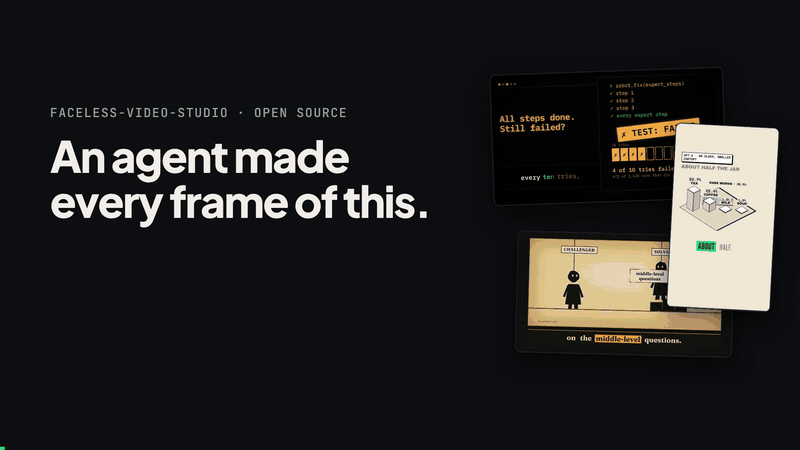
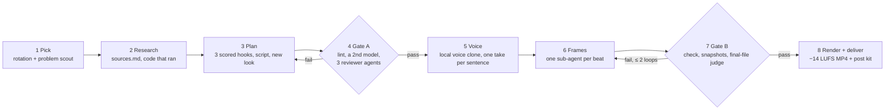

<div align="center">

# Faceless Video Studio

**A Claude Code skill that researches, scripts, voices and renders a finished explainer video
every day — with [HyperFrames](https://github.com/heygen-com/hyperframes), an open-source
clone of your own voice that runs offline (English and Hindi), and 40 pass/fail gates that
stop AI slop before it ships.**

No camera. No avatar. No editing timeline. No voice subscription. The only thing you pay for
is Claude Code. You review an MP4 in the morning and post it, or hand its `POST.json` to your
own uploader and let cron do it.

<a href="https://github.com/cybiqon-ai/faceless-video-studio/releases/download/v1.0.1/demo.mp4"></a>

<sub>Real output: a blog explainer the studio made on 12 Oct 2026, contact sheets from its first 14 videos, and the demo pieces of the seven animate styles it ships with. ▶ <a href="https://github.com/cybiqon-ai/faceless-video-studio/releases/download/v1.0.1/demo.mp4">Watch the 40-second version with sound</a> (narrated with the HeyGen clone the studio used before it moved to open-source voices).</sub>

[](LICENSE)


[How it works](#how-it-works) · [Quickstart](#quickstart) · [What it costs](#what-it-costs) ·
[The gates](#the-40-gates) · [Plug it in](#plug-it-into-your-pipeline) · [Scheduling](docs/scheduling.md) · [The full story](https://cybiqon.in/lab/open-source-ai-video-studio-claude-code)

</div>

---

## What it makes

Real videos made by this studio, narrated by a clone of the founder's voice. The first three
use the open-source Pocket TTS clone the studio runs today, made offline on a 4-core CPU; the
last three used the HeyGen clone it had before 15 Oct 2026:

| Video | Format | What it shows |
|---|---|---|
| [In this puzzle game, light can teleport. Stones can't.](https://youtu.be/PHj-BNQHcuE) | 47 s product Short | Real gameplay driven by the game's own solver: the mechanic shown, then solved |
| [Coding agents ace benchmarks. On 95 realistic delivery jobs, the best resolved 14](https://youtu.be/1j_GwfF1mSY) | 149 s explainer | A research paper explained from its own pages, split-screen |
| [A 3B-active model tied Kimi K3 on Kaggle](https://youtu.be/NtXKZbDEovs) | 148 s explainer | What actually did the work, from the source write-up |
| [Google gave its newest AI real jobs](https://youtu.be/Tuv_wF5Yhw4) | 117 s explainer | Real source-page footage with highlights drawn on the exact sentences |
| [Jev, explained](https://youtu.be/el5VAfAQASM) | 118 s explainer | A blog post turned into a teaching video |
| [How OpenAI trained agents to run enterprise software](https://youtu.be/sXXElHX-7SU) | explainer | News explained for a beginner |

It ships with **pillars** for AI terms, Python, build-a-thing, tech news, product and service
promos and blog explainers, plus **4–8 minute long-form deep dives**, **22 look families** so
two videos in a row never share a template, and **three render engines** (HyperFrames,
plus the vendored [animate](https://github.com/cth9191/animate) styles and optional Manim).

## How it works



1. **Pick.** `ledger.py today` returns the day's pillar and format from your rotation, and
   refuses any topic close to a video you have ever made. For teaching videos, a
   [problem scout](skill/video-studio/references/problem-scout.md) agent first searches
   Stack Overflow, GitHub issues, Hacker News, Google's "People also ask" and developer forums
   (≥ 12 searches, ≥ 4 kinds of source) for problems developers are actually asking about, and
   the video has to start from one that scores ≥ 9/15 with ≥ 2 links as proof (A21).
2. **Research.** Every fact gets a source URL. Teaching videos run their code first, and only
   the real output goes on screen.
3. **Plan.** Three hooks from a library of 20 real-Short templates, scored out of 12; a
   35–60 s script for developers who already code, with an artifact worth saving; and a
   look chosen from the least recently used families.
4. **Gate A — before any time is spent on voice.** A linter; then, optionally, a
   **second opinion from a different model family** via OpenRouter, which reviews the script
   and writes its own version so the agent can adopt what's better (A22, about $0.03 a script);
   then three fresh sub-agents: a mid-level developer who must name something new it learned
   (with a separate judge), an expert who flags anything false, and a cold viewer who sees only
   the first three seconds.
5. **Voice.** One take per sentence from an open-source clone of your voice, made on your own
   CPU: [Pocket TTS](https://github.com/kyutai-labs/pocket-tts) for English,
   [IndicF5](https://github.com/AI4Bharat/IndicF5) for Hindi and 10 other Indian languages.
   Each take is timed with faster-whisper and trimmed on the real sound (never on timestamps,
   which run late and cut words), levelled to −16 LUFS, and recorded in a hash manifest.
6. **Frames.** One sub-agent per beat builds HTML + GSAP in parallel; HyperFrames assembles.
7. **Gate B.** `hyperframes check`, snapshots the agent actually looks at, and a judge that
   reviews frames decoded from the final MP4.
8. **Deliver.** `deliver.py` refuses the video unless every review line is present, every
   voice line is clean, the music sits ≥ 20 dB under the voice (`mix_check.py`) and a Short
   fills its frame; then it sends the MP4 and a post kit (titles, descriptions, hashtags,
   tracked links, sources) to Telegram — or saves it locally — and prints one
   `Rendered: <slug> …` line a scheduler can check.

The studio itself **never posts**: you decide what goes out under your name. Watch it and post
it by hand, or [plug in your own uploader](#plug-it-into-your-pipeline) — we post ours to
YouTube and X from cron.

## Quickstart

You need **Linux** (we run Ubuntu 24.04; macOS works with GNU `timeout` and `flock` from
Homebrew), **Node.js 22+**, **Python 3.10+**, **FFmpeg**,
[Claude Code](https://code.claude.com), a free [Hugging Face](https://huggingface.co) account
(the voice models are gated) and ~5 GB of disk for them. No GPU and no paid voice service.

**1. Install HyperFrames and its agent skills** (they provide the renderer and the media
helpers for music, sound effects and captions):

```bash
claude plugin marketplace add heygen-com/hyperframes
claude plugin install hyperframes@hyperframes
# or, without the plugin:
npx skills add heygen-com/hyperframes
```

**2. Install this skill.** Either as a Claude Code plugin (one command, auto-updates):

```bash
claude plugin marketplace add cybiqon-ai/faceless-video-studio
claude plugin install faceless-video-studio@faceless-video-studio
mkdir ~/my-studio   # your studio folder; step 5's setup fills it
```

…or clone it and run the installer, which checks your tools, links the skill into
`~/.claude/skills/video-studio` and creates the studio folder from `studio.example/`:

```bash
git clone https://github.com/cybiqon-ai/faceless-video-studio.git
cd faceless-video-studio
./install.sh ~/my-studio
```

As a plugin the command is `/faceless-video-studio:video-studio`; below it's written
`/video-studio`.

**3. Install a voice engine.** Accept the model's terms on Hugging Face
([Pocket TTS](https://huggingface.co/kyutai/pocket-tts) for English,
[IndicF5](https://huggingface.co/ai4bharat/IndicF5) for Hindi), log in once, then install it
into your studio (its own virtualenv in `~/my-studio/.venvs/`, CPU-only):

```bash
pip install -U huggingface_hub && hf auth login
STUDIO_ROOT=~/my-studio skill/video-studio/scripts/install_voice.sh pocket    # English
STUDIO_ROOT=~/my-studio skill/video-studio/scripts/install_voice.sh indicf5   # Hindi (optional)
```

**4. Record your voice once** — 20–30 s of natural, expressive speech in a quiet room, saved
as `~/my-studio/voice/sample.wav`. For Hindi, record a separate Hindi take and keep a 6–10 s
clip of it that ends on a pause, with its exact words in `config.json`
(`voice.variants.hi.reference_text`). [docs/voice.md](docs/voice.md) has the scripts to read
and what makes a clone sound like you.

**5. Run setup.** It checks FFmpeg, HyperFrames and the voice engine, and voices two test
sentences in your voice for you to approve:

```bash
cd ~/my-studio && claude
> /video-studio setup
```

**6. Make it yours.** Edit `brand/brand-core.md` (your accent colour and handle),
`brand/pillars.md` (your audience, products and honest tie-ins) and `brand/products.json`
(the links promos point to). `examples/cybiqon/` is a real, filled-in brand.

**7. Make your first video** and watch it end to end:

```bash
> /video-studio plan "what an embedding is"   # research + plan + Gate A only, no spend on voice
> /video-studio daily                          # the full run: today's pillar from your rotation
```

The MP4 lands in `videos/<date>-<slug>/hf/renders/video.mp4`, with `POST-KIT.html` beside it.

**8. Optional: get it on Telegram.** Add `TELEGRAM_BOT_TOKEN` and `TELEGRAM_CHAT_ID` to
`.env` and test it from your studio:
`cd ~/my-studio && python3 ~/faceless-video-studio/skill/video-studio/scripts/telegram.py "hello"`.

**9. Optional: more engines.** The animate styles need `npm install` in
`skill/video-studio/vendor/animate`; Manim needs its own venv. The installer prints both
commands.

**10. Schedule it** once a few manual runs look right — see [docs/scheduling.md](docs/scheduling.md):

```cron
PATH=/home/USER/.nvm/versions/node/v22.11.0/bin:/home/USER/.local/bin:/usr/local/bin:/usr/bin:/bin
0 23 * * *  STUDIO_ROOT=/home/USER/my-studio /home/USER/faceless-video-studio/bin/run.sh
```

Cron has a short `PATH`: set it to wherever `claude`, `node` and `npx` live (`which claude node`).
With the plugin install, add `STUDIO_SKILL=faceless-video-studio:video-studio` and call the
`bin/run.sh` from a clone of this repo.

## What it costs

From the studio's own first four days (October 2026), where it made 12 finished videos:

| Item | Cost |
|---|---|
| Voice, open-source on your CPU | **$0**: Pocket TTS ~1× real time (English), IndicF5 ~30× (Hindi) on 4 cores |
| Voice before 15 Oct 2026 (HeyGen clone, for comparison) | $8.20 for all 12 videos plus revisions (~$0.14 per minute of narration) |
| Claude Code run, one 85 s Short | ~$18.35 (estimate reported by Claude Code; ~$10 of it the 11 parallel frame workers) |
| Claude Code run, a 7-minute long-form + its companion Short | ~$26 |
| Rendering | your own CPU: 2.5–19.5 min per video on 4 cores |

The six runs whose cost we logged between 12 and 17 Oct 2026 (Shorts and 2.5-minute
explainers) cost **$11–20.50** each. Optional
extras cost cents: the A22 second opinion is about **$0.03** a script on OpenRouter, and a
`HEYGEN_API_KEY`, if you set one, is used only by HyperFrames' own music and sound-effect
search — never for the voice.

All of the required spend is the agent. `bin/run.sh` caps every run with
`--max-budget-usd` ($25 for a Short, $60 for a long-form by default), and `POST.json` has a
`cost_usd` field: fill it from day one. The full breakdown is in the
[write-up](https://cybiqon.in/lab/open-source-ai-video-studio-claude-code).

## The 40 gates

Most of them exist because a real video failed in exactly that way. `deliver.py` refuses a
video unless the review pass lines are in its plan (A16, A18–A21, and A22 when a second-opinion
model is set), and it checks the voice (B17), the frame fill (B18) and the music level itself:

| Gate | Rule | The failure behind it |
|---|---|---|
| **A8** | 35–60 s, the configured pause after sentences kept; cut sentences, not pauses | The first Short: 97 words in 44 s, "too fast"; later, 60–90 s beginner pacing lost 67 % in 3 s |
| **A14–A16, A18** | Written for developers who already code; ≥ 1 artifact and 3 specifics per 30 s; linted; a mid-level developer must learn something new | First "the script considers the viewer as an expert", then the beginner rewrite: "too childish… I didn't get anything useful" |
| **A19** | An expert agent flags anything false | Three simplifications that had become untrue |
| **A2, A20** | Sentence 1 names the concrete subject plus a tension, proven on screen by 1.5 s | "The hook doesn't make sense"; then 67 % swiping away in 3 s |
| **B11, B13** | Footage fills the frame; no two videos look like one template | "Quite similar… it will soon be noticed as AI generated" |
| **B16, B17** | No silence over the configured pause (0.7 s default); every voice line starts and ends on silence | Gaps of 3–5 s; a third of sentences losing their first word |
| **A21** | A teaching video starts from a problem developers are asking about: ≥ 2 public links, ≥ 9/15 | A true, well-made Short about a problem nobody had: "no point making a video on a problem which no one is facing" |
| **A22** | A model from another family reviews the script and writes its own version | Scripts that passed every Claude-judged gate and still taught nothing |
| **B18** | A Short fills its frame to the bottom edge | An empty bottom 40% on every Short |
| `mix_check` | Voice levelled to −16 LUFS; music ≥ 20 dB under it | "The voiceover is still low" |

All 40, with what each checks: [docs/gates.md](docs/gates.md). The rubric the agent works
from: [`skill/video-studio/references/quality-rubric.md`](skill/video-studio/references/quality-rubric.md).

## Plug it into your pipeline

The studio is built to be one stage in your own system, not a closed app.

- **One command to run it.** `bin/run.sh [daily|promo|blog|plan <topic>|…]` runs
  `claude -p "/video-studio <mode>"` headless with a lock, a time limit, a spend cap and a deny
  list, and alerts you when no video came out. Exit 0 with no `Rendered:` line counts as a
  failure. Several tracks (we run blog explainers at 12:30, a product Short at 15:15 and a
  teaching video at 23:00) share one machine through the lock.
- **Four plugins**, each a small Python file named in `config.json`, connect it to your
  systems without forking: `planner` (a content calendar chooses topics and gets marked
  "made"), `notify` (Telegram by default; Slack, email or your own bot),
  `links` (tracked links to your products) and `archive` (keep final renders in cloud
  storage). See [configuration.md](docs/configuration.md#plugins).
- **One file to hand on.** Every delivered video has `videos/<date>-<slug>/POST.json`,
  validated by `deliver.py`: three titles, a YouTube description, a caption without URLs,
  hashtags, a pinned comment, `thumbnail_at`, sources and `cost_usd`. The MP4 is
  `hf/renders/video.mp4` beside it.

**To post automatically**, run your uploader after `bin/run.sh` prints its `Rendered:` line:
read `POST.json`, upload the MP4, and keep a ledger keyed by slug so a retry never posts
twice. Ours schedules the product Short on YouTube (Data API v3, private with
`status.publishAt`, one playlist per product), posts the same MP4 to X at the same time
(API v2 chunked upload; no link in the text, because X charges $0.20 instead of $0.015 for a
post with a URL), and checks 30 minutes later that it really went public. How it's wired, with
the schedule and costs: [the write-up](https://cybiqon.in/lab/open-source-ai-video-studio-claude-code).

## What's in the box

```
skill/video-studio/
  SKILL.md                 the skill: modes, pipeline, rules
  references/              the rubric, 22 looks, pillars, prompt library, 9 craft notes
  scripts/                 ledger, deliver, voice_build + tts_engine + install_voice,
                           script_lint, second_opinion, gap/fill/mix checks, tests
  templates/               PLAN.md and BRIEF.md
  assets/                  caption skins, fonts (OFL), placeholder brand
  vendor/animate/          cth9191/animate (MIT), a second engine with 7 styles
bin/run.sh                 unattended runner: lock, ceilings, budget cap, count-not-status alert
install.sh                 prerequisite check, skill link, studio scaffold
studio.example/            config.json, .env template, brand/ to copy and edit
examples/cybiqon/          a real, filled-in brand and three-track config
docs/                      setup, configuration, voice, scheduling, gates, troubleshooting
```

## Documentation

- [Setup, step by step](docs/setup.md)
- [Configuration: tracks, rotation, plugins](docs/configuration.md)
- [Cloning your voice, English and Hindi](docs/voice.md)
- [Running it on a schedule](docs/scheduling.md)
- [All 40 gates](docs/gates.md)
- [The problem scout: picking topics people actually have](skill/video-studio/references/problem-scout.md)
- [Troubleshooting: every trap we hit](docs/troubleshooting.md)

## FAQ

**Does it need an avatar or a camera?** No. Every visual is an animated HTML scene, a real
web page captured in a browser, or real product footage. The voice is a clone of your own,
made on your machine.

**Which languages can it speak?** English with Pocket TTS, Hindi (and Bengali, Gujarati,
Kannada, Malayalam, Marathi, Odia, Punjabi, Tamil, Telugu, Assamese) with IndicF5. Put a
second voice under `voice.variants` in `config.json` and pick it with
`voice_build.py --voice hi`. Write Hindi scripts the way people talk (Hinglish, "तो हुआ ये
कि…"), not textbook Hindi, or the clone sounds flat.

**Can I use another voice engine?** Add a class with `say(text) -> samples` to
`scripts/tts_engine.py` and an install recipe to `install_voice.sh`. Keep the
trim-on-real-sound logic and the manifest in `voice_build.py`: the B17 gate depends on them.

**Does it post for me?** Not by itself, on purpose: it delivers a video, a post kit and a
machine-readable `POST.json`, and a person should decide what goes out under their name. If
you want posting automated, a small uploader that reads `POST.json` after each run is all it
takes — see [Plug it into your pipeline](#plug-it-into-your-pipeline). We post to YouTube and X
that way; Instagram and Facebook we still post by hand.

**How does it choose topics?** From your rotation (or your content calendar, through the
`planner` plugin). For teaching videos, a problem-scout agent then finds problems developers
are visibly asking about this quarter, and the studio refuses to deliver a video whose problem
isn't backed by at least two public links (gate A21).

**Does it need HeyGen?** No. The voice has been Pocket TTS and IndicF5, offline, since
15 Oct 2026. HyperFrames, the renderer, is an open-source project from HeyGen that needs no
HeyGen account; an optional `HEYGEN_API_KEY` only enables its music and sound-effect search.

**How long does a run take?** `bin/run.sh` caps a Short at 3 hours and a long-form at 7
(both configurable); most of that time goes on research and the review agents, not
rendering. Our renders took 2.5–19.5 minutes on 4 cores.

**Will it make the same video twice?** `ledger.py check` refuses a topic that overlaps any
video you have made, and `look-check` refuses a look family used in the last six videos.

## Credits

Built by [Cybiqon](https://cybiqon.in) and run daily on our own channels. How it runs today —
offline voices, three tracks a day, auto-posting to YouTube and X, and what it costs:
[*We deleted the voice bill. Now the studio posts its own videos.*](https://cybiqon.in/lab/open-source-ai-video-studio-claude-code)
How it was built, what broke first and what it cost then:
[*Twelve videos in four days. Nobody picked up a camera.*](https://cybiqon.in/lab/hyperframes-heygen-ai-video-pipeline)

Stands on [HyperFrames](https://github.com/heygen-com/hyperframes) (Apache 2.0),
[Pocket TTS](https://github.com/kyutai-labs/pocket-tts) by Kyutai (code MIT, model CC-BY-4.0),
[IndicF5](https://github.com/AI4Bharat/IndicF5) by AI4Bharat (MIT),
[faster-whisper](https://github.com/SYSTRAN/faster-whisper) (MIT),
[animate](https://github.com/cth9191/animate) by cth9191 (MIT, vendored),
[Manim](https://www.manim.community/) (MIT, optional), and lessons from
[awesome-opus5-5-videos](https://github.com/yihui-dev/awesome-opus5-5-videos) (MIT). See
[THIRD_PARTY_NOTICES.md](THIRD_PARTY_NOTICES.md).

## License

[MIT](LICENSE) © 2026 Cybiqon AI Solutions. Vendored and bundled third-party files keep their own licences.
